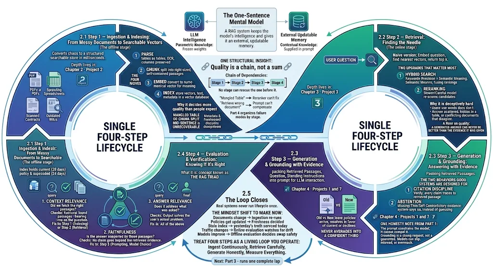
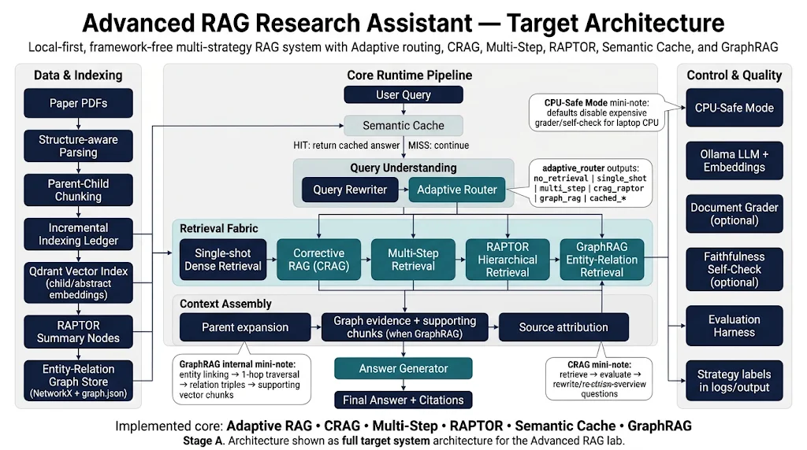

<p align="center">
  
</p>

# 🧠 AI Research Assistant


[](https://www.python.org/)
[](https://opensource.org/licenses/MIT)
[](https://ollama.ai)
[](https://qdrant.tech/)
[](https://github.com/arashnicoomanesh/ai-research-assistant)
[](https://github.com/arashnicoomanesh/ai-research-assistant)

> **A local, privacy-first RAG system for AI research papers — built from scratch without LangChain or LlamaIndex.**
---

## 📑 Table of Contents

- [Why This Project?](#-why-this-project)
- [Features](#-features)
- [Current Implementation Status](#-current-implementation-status)
- [Architecture](#-architecture)
- [Supported Query Strategies](#-supported-query-strategies)
- [Demo: Automatic Strategy Selection](#-demo-automatic-strategy-selection)
- [Quick Start](#-quick-start)
- [Installation](#-installation)
- [Usage](#-usage)
  - [Ingest Papers](#-ingest-papers)
  - [Build RAPTOR Summaries](#-build-raptor-summaries)
  - [Build GraphRAG Knowledge Graph](#-build-graphrag-knowledge-graph)
  - [Ask Questions](#-ask-questions)
  - [Run Evaluations](#-run-evaluations)
- [Project Structure](#-project-structure)
- [Limitations & Notes on CPU Usage](#-limitations--notes-on-cpu-usage)
- [Contributing](#-contributing)
- [License](#-license)

---

## 🎯 Why This Project?

Most RAG tutorials rely on frameworks like LangChain or LlamaIndex, which abstract away the core logic. This project takes the opposite approach: **every component is implemented explicitly** so you can see exactly how a production-grade RAG pipeline works. It runs entirely on your local machine using **Ollama** for LLM/embedding services and **Qdrant** as the vector database—no cloud APIs, no hidden magic, no data leaving your computer.

Whether you're learning RAG internals, researching AI papers, or building a privacy-sensitive document QA system, this repository provides a transparent, hackable foundation.

---

## ✨ Features

| Category | Description |
|---|---|
| **🔒 Local-first** | Runs entirely on your machine with Ollama + Qdrant (no cloud APIs). |
| **📄 Structure-aware chunking** | Preserves paper sections (Abstract, Introduction, Methods, Results, etc.). |
| **🔍 Dense vector retrieval** | Qdrant vector search with child-chunk granularity + parent expansion. |
| **🧭 Adaptive routing** | Chooses the retrieval strategy based on query type/intent. |
| **📊 Document grading** | Filters irrelevant retrieved chunks; only relevant chunks are used (OFF by default in CPU mode). |
| **📝 Cited answers** | Generates responses with paper citations and source metadata. |
| **🔄 Corrective RAG (CRAG)** | Iterative retrieval with automatic correction when results are poor. |
| **🧩 Multi-step retrieval** | Decomposes complex questions into sub-questions and retrieves per sub-question. |
| **🌳 RAPTOR summaries** | Builds hierarchical summary layers from child chunks for improved retrieval. |
| **🕸️ GraphRAG** | Local knowledge-graph extraction and relational retrieval (Stage A). |
| **⚡ Semantic cache** | Caches question→answer mappings for repeat queries (fast, no re-computation). |
| **✅ Faithfulness self-check** | Validates that generated answers are supported by retrieved sources (OFF by default in CPU mode). |
| **📈 Evaluation harness** | Runs structured evaluations with metrics (latency, faithfulness, citation rate). |

---

### 📊 Current Implementation Status

> Honest snapshot of what works today, not a roadmap. Last verified: `2026-11-15`.

#### 📥 A. Data & Indexing

| Capability | Status | Notes |
|---|---|---|
| PDF ingestion | ✓ Working | 6 papers ingested |
| Structure-aware parsing | ✓ Partial | `pdfplumber` path works; Docling optional / fallback |
| Parent-child chunking | ✓ Working | Child for search, parent for expansion |
| Incremental indexing (hash + SQLite) | ✓ Working | Record manager tracks papers |
| Qdrant vector index | ✓ Working | `ai_papers` collection live |
| Embed children / abstract only | ✓ Working | CPU-safe indexing |
| RAPTOR summary nodes | ✓ Working | Build + retrieval verified; summaries > 0 |

#### 🔍 B. Core Query Pipeline

| Capability | Status | Notes |
|---|---|---|
| CLI question interface | ✓ Working | positional + `--question` + interactive |
| Semantic cache | ✓ Working | exact repeat = cache HIT |
| Query rewriting | ✓ Working | sometimes over-generalizes entities |
| Adaptive routing | ✓ Working | `no_retrieval` / `single_shot` / `multi_step` / `crag_raptor` / `graph_rag` |
| Dense retrieval (`query_points`) | ✓ Working | modern Qdrant API |
| Parent expansion | ✓ Working | lookup by payload `chunk_id` |
| Answer generation + citations | ✓ Working | grounded answers returned |
| CPU-Safe Mode | ✓ Working | default ON for target hardware |

#### 🧩 C. Advanced RAG Modules

| Module | Status | Evidence |
|---|---|---|
| Adaptive RAG | ✓ Implemented | Router chooses strategy by query type |
| Corrective RAG (CRAG) | ✓ Implemented (lightweight in CPU mode) | rewrite / merge path used successfully |
| Multi-Step Retrieval | ✓ Implemented | decomposition + per-sub retrieval code path |
| RAPTOR | ✓ Working | builder + retriever paths verified |
| GraphRAG (Stage A) | ⚠️ Partial | local graph + extraction + retrieval + routing; entity linking noisy; graph may contain extraction noise |
| Semantic Caching | ✓ Implemented | HIT path verified |
| Self-check / faithfulness | ⚠️ Implemented but OFF by default | disabled in CPU-Safe Mode |
| LLM document grading | ⚠️ Implemented but OFF by default | falls back to vector score ranking |

#### 🛠️ D. Engineering / Ops

| Capability | Status | Notes |
|---|---|---|
| Environment checker | ✓ | — |
| Ingest / stats CLI | ✓ | stats vector count display still buggy |
| Eval harness | ✓ | code present |
| README / packaging | ✓ | — |
| GitHub repo + CI | ✓ | passing |
| Architecture diagram in `docs/` | ✓ | added |

---

### What works well now
- End-to-end question answering with citations on local hardware
- RAPTOR hierarchical summaries built and retrieved correctly
- GraphRAG answers technique/relational queries (e.g., "What techniques does X introduce?")
- CPU-safe defaults keep the system responsive on 3B models
- Semantic cache makes repeat queries instant

### Known limitations (GraphRAG)
- Entity extraction noise: some spurious entities/relations in `graph.json`
- Entity linking is heuristic (exact + fuzzy + token overlap) — can over-link or miss variants
- Graph is built from CPU-model extractions; quality improves with larger models
- No community detection / global report generation (Microsoft-style GraphRAG not implemented)
- `--dedupe` cleans aliases post-hoc but does not fix extraction errors

---

## 🏗️ Architecture


---

## 🧭 Supported Query Strategies

The adaptive router selects a strategy for each query. Supported strategies:

| Strategy | Description | When Used |
|---|---|---|
| `no_retrieval` | Answer from model knowledge without retrieval. | Simple factual questions, general knowledge. |
| `single_shot` | Corrective RAG (CRAG) — iterative retrieval with grading. | Standard queries needing paper evidence. |
| `multi_step` | Decompose question into sub-questions, retrieve per sub-question. | Complex multi-part questions. |
| `crag_raptor` | RAPTOR-enhanced hierarchical retrieval using summary layers. | Deep research questions needing structure. |
| `graph_rag` | Knowledge graph retrieval with entity linking + neighborhood traversal. | Relational queries (how X relates to Y, what uses X, etc.). |
| `cached_*` | Answer served from semantic cache (fast path). | Repeat queries. |

Each strategy produces a **labeled answer** (e.g., `crag_refine`, `multi_step_3sub_2retrievals`, `raptor_survey`, `graph_rag_relational`) so you can see exactly which path was taken.

---

## 🎬 Demo: Automatic Strategy Selection

The router picks the strategy automatically. Run these and watch the strategy label in the output:

```bash
# Definition → single_shot (CRAG path)
python src/main.py "What is Self-RAG?"

# Technique extraction → graph_rag
python src/main.py "What techniques does Self-RAG introduce?"

# Relational → graph_rag
python src/main.py "How is Self-RAG related to CRAG?"

# Survey / overview → crag_raptor (RAPTOR path)
python src/main.py "Give me an overview of advanced RAG methods in these papers"

# Repeat → cached_* (instant)
python src/main.py "What is Self-RAG?"
```

**Expected behavior at a high level** (quality varies by CPU model size and graph noise):
| Query type | Strategy | Typical output |
|---|---|---|
| "What is X?" | `single_shot` / `cached_*` | Definition with citation |
| "What techniques does X introduce?" | `graph_rag` | List of techniques from graph edges |
| "How is X related to Y?" | `graph_rag` | Path/edges between entities |
| "Overview of Z" | `crag_raptor` | Summary drawn from RAPTOR layers |
| Repeat query | `cached_*` | Instant cached answer |

> Note: forced `--strategy` CLI flag is not the main interface yet; auto-routing + env flags (`CPU_SAFE_MODE`) control behavior.

---

## 📑 Quick Start

For the impatient, here's the minimal path to a working system:

```bash
# 1. Clone the repo
git clone https://github.com/arashnicoomanesh/ai-research-assistant.git
cd ai-research-assistant

# 2. Install Python dependencies
pip install -r requirements.txt

# 3. Start Ollama and pull models
ollama serve
ollama pull qwen2.5-coder:3b
ollama pull nomic-embed-text:v1.5

# 4. Start Qdrant (Docker)
docker run -d -p 6333:6333 -p 6334:6334 \
  -v $(pwd)/qdrant_storage:/qdrant/storage \
  qdrant/qdrant

# 5. Configure environment
cp .env.example .env

# 6. Ingest papers (place PDFs in data/papers/ first)
python scripts/ingest_papers.py

# 7. Ask a question
python src/main.py "What is the attention mechanism in transformers?"
```

> **Prerequisites:** Python 3.10+, [Ollama](https://ollama.ai), [Docker](https://docker.com) (for Qdrant).

---

## 🛠️ Installation

### 1. Install Python Dependencies

```bash
pip install -r requirements.txt
```

### 2. Install & Start Ollama

```bash
# Download from https://ollama.ai, then:
ollama serve

# Pull required models
ollama pull qwen2.5-coder:3b      # LLM for generation
ollama pull nomic-embed-text:v1.5 # Embedding model for search

# Verify models are available:
ollama list
```

### 3. Install & Start Qdrant (via Docker)

```bash
# Install Docker from https://docker.com, then:
docker run -d -p 6333:6333 -p 6334:6334 \
  -v $(pwd)/qdrant_storage:/qdrant/storage \
  qdrant/qdrant

# Verify Qdrant is running:
curl -s http://localhost:6333/ | head -5
# Or visit http://localhost:6333 in your browser
```

### 4. Configure Environment

```bash
cp .env.example .env
# Edit .env if needed (default settings should work for most cases)
```

### 5. (Optional) Download Additional Models

See `.env.example` for available model names.

---

## 🚀 Usage

### 📥 Ingest Papers

1. Place PDF papers in the `data/papers/` directory.
2. Run ingestion:

```bash
# Incremental (default) — only processes new/changed papers
python scripts/ingest_papers.py

# Force re-index all papers (ignores hashes)
python scripts/ingest_papers.py --force

# Show statistics only
python scripts/ingest_papers.py --stats

# Clean records for deleted files
python scripts/ingest_papers.py --clean
```

**What happens during ingestion:**
- PDFs are parsed using `docling` (structure-aware).
- Text is chunked using a parent-child hierarchy (parent chunks for summaries, child chunks for retrieval).
- Chunks are indexed into Qdrant vector database.
- Record metadata tracks processed files and hashes.

### 🌳 Build RAPTOR Summaries

RAPTOR builds hierarchical summary layers from child chunks, enabling better retrieval for deep research questions. Build takes ~2–5 min per paper on CPU (3B model).

```bash
# Build all summaries for all papers
python scripts/build_raptor.py

# Build for one paper by ID
python scripts/build_raptor.py --paper ai_papers

# Limit number of groups (useful for testing)
python scripts/build_raptor.py --limit 5

# Check existing summaries without building
python scripts/build_raptor.py --check

# Build all but limit to first N groups
python scripts/build_raptor.py --all --limit 3
```

### 🕸️ Build GraphRAG Knowledge Graph

GraphRAG extracts entities and relations from paper content to build a local knowledge graph, enabling relational queries like "How is X related to Y?" or "What methods are based on X?"

**Recommended (CPU-friendly, abstracts-first):**
```bash
# Build graph from abstracts only (fast, ~30–60s)
python scripts/build_graph.py --limit 8

# Or rebuild abstracts to enrich an existing graph
python scripts/build_graph.py --rebuild-abstracts --limit 12
```

**Full / incremental options:**
```bash
# Build graph for all papers (abstracts + sections; slower, ~5–15 min)
python scripts/build_graph.py

# Build for one paper by ID
python scripts/build_graph.py --paper ai_papers

# Show graph statistics without building
python scripts/build_graph.py --stats

# Deduplicate existing graph nodes by alias merge (no LLM, ~1s)
python scripts/build_graph.py --dedupe
```

**GraphRAG process:**
- Retrieves paper chunks from Qdrant (prioritizing abstracts and important sections).
- Extracts entities and relations using the LLM with a structured prompt (3-stage fallback for CPU models).
- Normalizes entity IDs and merges aliases (e.g., "Self-RAG" / "SELF-RAG" / "Self Reflective Retrieval-Augmented Generation" → `self-rag`).
- Stores entities and relations in a local NetworkX graph persisted as `data/graph/graph.json`.
- Supports incremental builds (skips already processed chunks; `--dedupe` merges aliases post-hoc).
- `graph.json` is a local runtime artifact (not committed to git).

### 💬 Ask Questions

```bash
# Basic query (interactive or single-shot)
python src/main.py "What is the attention mechanism in transformers?"

# Interactive mode
python src/main.py --interactive

# With verbose logging
python src/main.py -v "Compare transformer architectures"
```

**Query flow:**
1. Semantic cache check (if HIT, returns cached answer immediately).
2. Query rewriting for better retrieval.
3. Adaptive routing selects the best strategy.
4. Retrieval, grading (if enabled), and generation.
5. Faithfulness self-check (if enabled).
6. Answer returned with citations.

### 📊 Run Evaluations

The evaluation harness reads a JSONL file of questions and collects metrics.

```bash
# Run all questions in the default file
python scripts/run_eval.py

# Run first 5 questions only
python scripts/run_eval.py --limit 5

# Run and save detailed report
python scripts/run_eval.py --output my_report.json

# Run with custom questions file
python scripts/run_eval.py data/eval/questions.jsonl --limit 10
```

**Evaluation output:**
- Summary metrics: average latency, cache hit rate, faithfulness rate, citation rate, retrieval success rate.
- Strategy distribution across all questions.
- Per-question details: strategy, latency, cache hit/fail, faithfulness.
- Detailed JSON report saved to the specified output path.

**Example questions JSONL format:**

```json
{"id": "1", "question": "What is attention mechanism?", "type": "factoid", "must_cite": true}
{"id": "2", "question": "Compare transformer and LSTM architectures", "type": "comparative", "must_cite": true}
{"id": "3", "question": "How does backpropagation work?", "type": "explain", "must_cite": false}
```

---

## 📂 Project Structure

```
ai-research-assistant/
├── data/
│   ├── papers/              # Raw PDF papers (user-provided)
│   ├── processed/           # Processed chunks (JSON) — gitignored
│   ├── eval/                # Evaluation questions and reports
│   ├── cache/               # Semantic cache JSON — gitignored
│   └── graph/               # GraphRAG runtime artifacts — gitignored
│       ├── graph.json       # NetworkX graph (local only)
│       └── processed_chunks.json
├── scripts/
│   ├── check_environment.py # Environment validation
│   ├── ingest_papers.py     # Incremental paper ingestion pipeline
│   ├── build_raptor.py      # RAPTOR hierarchical summary builder
│   ├── build_graph.py       # GraphRAG knowledge graph builder
│   └── run_eval.py          # Evaluation harness
├── src/
│   ├── main.py              # CLI entry point
│   ├── core/
│   │   ├── config.py        # Configuration management
│   │   ├── llm.py           # Ollama LLM client
│   │   └── embeddings.py    # Ollama embeddings client
│   ├── graph/
│   │   ├── __init__.py      # GraphRAG package
│   │   ├── schema.py        # Entity, Relation, GraphEvidence models
│   │   ├── entity_extractor.py # LLM-based entity/relation extraction
│   │   ├── graph_store.py   # NetworkX graph persistence
│   │   └── graph_retriever.py # Graph retrieval (entity linking + traversal)
│   ├── ingestion/
│   │   ├── pdf_parser.py    # PDF text extraction
│   │   ├── chunker.py       # Structure-aware chunking
│   │   ├── indexer.py       # Qdrant indexing
│   │   └── raptor_builder.py # RAPTOR summary building
│   ├── retrieval/
│   │   ├── hybrid_retriever.py   # Dense vector search + parent expansion
│   │   ├── grader.py             # Relevance grading
│   │   ├── query_rewriter.py     # Query rewriting
│   │   ├── semantic_cache.py     # Caching
│   │   ├── corrective_retriever.py # CRAG
│   │   ├── multi_step_retriever.py # Multi-step retrieval
│   │   ├── raptor_retriever.py     # RAPTOR retrieval
│   │   └── graph_retriever.py      # GraphRAG retrieval
│   ├── routing/
│   │   └── adaptive_router.py # Query routing
│   ├── generation/
│   │   └── answer_generator.py # Cited answer generation
│   └── evaluation/
│       ├── metrics.py         # Metrics computation
│       └── evaluator.py       # Evaluation orchestration
├── requirements.txt          # Python dependencies
├── .env.example              # Environment configuration template
├── README.md                 # This file
└── ...
```

---

## ⚠️ Limitations & Notes on CPU Usage

| Aspect | Note |
|---|---|
| **Model sizes** | Default LLM `qwen2.5-coder:3b` and embeddings `nomic-embed-text:v1.5` work on CPU but are slower. For better performance, consider larger models or GPU acceleration. |
| **Memory** | Loading multiple model instances consumes RAM. Default configuration is tuned for 8GB+ RAM. |
| **Qdrant** | Vector search on CPU is functional but slower than GPU-accelerated alternatives. |
| **RAPTOR** | Building summary layers requires multiple LLM calls. For large paper collections, use `--limit` to process incrementally. |
| **GraphRAG extraction** | Entity/relation extraction is slow on 3B CPU (~1–2 min per chunk). Prefer `--limit` and abstracts-first (`--rebuild-abstracts`). |
| **Multi-step** | Complex questions may generate multiple sub-questions, increasing latency proportionally. |
| **Cache** | Semantic cache provides speedup for repeat queries but cache entries expire with paper re-ingestion. |
| **CPU_SAFE_MODE** | Default ON: disables expensive grader, faithfulness self-check, and RAPTOR self-check to keep latency acceptable. |
| **First-run latency** | First answers may take 1–4 minutes; cache makes repeats fast. |

---

## 🤝 Contributing

Contributions are welcome! Here's how you can help:

1. **Report bugs** — Open an issue with a clear description and reproduction steps.
2. **Suggest features** — Open an issue explaining the use case and proposed solution.
3. **Submit pull requests** — Fork the repo, create a feature branch, and submit a PR with a clear description of changes.
4. **Improve documentation** — Fix typos, clarify instructions, or add examples.

Please ensure your code follows the existing style and includes tests where applicable.

---

## 📄 License

This project is licensed under the **MIT License**. See the [LICENSE](LICENSE) file for details.