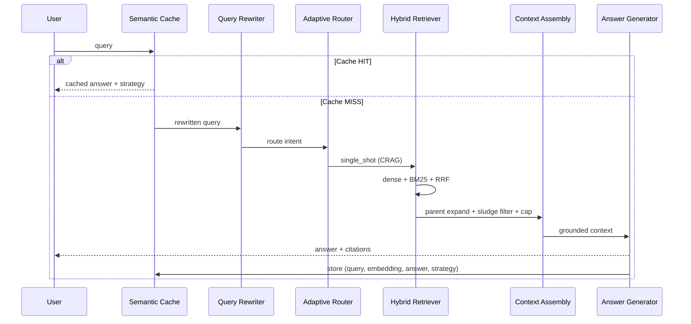

<div align="center">

# RAG Laboratory, AI Research Assistant

A local-first, framework-free RAG laboratory that implements Adaptive routing, CRAG, multi-step retrieval, RAPTOR-inspired summaries, semantic cache, and Stage-A GraphRAG in one coherent CPU-runnable system.

[](https://www.python.org/)
[](https://opensource.org/licenses/MIT)
[](https://ollama.ai)
[](https://qdrant.tech/)
[](https://github.com/arashnicoomanesh/ai-research-assistant)
[](https://github.com/arashnicoomanesh/ai-research-assistant)
[](https://github.com/arashnicoomanesh/ai-research-assistant/releases/tag/v0.4.0)

</div>

---

## Table of Contents

- [Why this repo](#why-this-repo)
- [Features at a glance](#features-at-a-glance)
- [How it works](#how-it-works)
- [Query strategies](#query-strategies)
- [Reliable vs Experimental vs Forced](#reliable-vs-experimental-vs-forced)
- [Quick Start](#quick-start)
- [Installation](#installation)
- [Usage](#usage)
- [Implementation status](#implementation-status)
- [Architecture](#architecture)
- [GraphRAG Stage A](#graphrag-stage-a)
- [Project structure](#project-structure)
- [Configuration highlights](#configuration-highlights)
- [Evaluation & ablations](#evaluation--ablations)
- [Limitations & CPU notes](#limitations--cpu-notes)
- [Security notes](#security-notes)
- [Roadmap & non-goals](#roadmap--non-goals)
- [Contributing](#contributing)
- [License](#license)

---

## Why this repo

- **Explicit implementations** — Core RAG logic written from scratch; no LangChain/LlamaIndex in the critical path.
- **Multi-strategy RAG in one local system** — Adaptive routing, CRAG, multi-step, RAPTOR-inspired, GraphRAG (Stage A), semantic cache.
- **CPU-runnable defaults** — 3B LLM + embeddings run on 8 GB RAM; `CPU_SAFE_MODE` keeps latency acceptable.
- **Inspectable routing decisions** — Every answer shows the chosen strategy (`graph_rag_relational`, `raptor_survey`, `crag_refine`, `cached_*`).
- **Honest status** — Capability map below is the target scope; status audit is separate and dated.

> **Positioning:** This repository is a **RAG laboratory** — a complete, hackable system where several RAG techniques are implemented explicitly and run locally. It is not a wrapper around a framework; it is the framework, laid bare for study and extension. Use it to learn RAG internals, answer questions over AI research papers, or prototype new retrieval strategies without cloud APIs or hidden abstractions.

---

## Features at a glance

| Area | Capability |
|------|------------|
| **Ingestion** | PDF → structure-aware parsing → parent/child chunking → Qdrant dense vectors + BM25 keyword index |
| **Retrieval** | Hybrid dense + BM25 with RRF (k=60); optional cross-encoder rerank (OFF by default); parent expansion with score inheritance |
| **Query processing** | Entity-aware rewrite → adaptive routing (heuristics + optional LLM) → strategy selection |
| **Advanced modules** | CRAG (corrective loop), Multi-step (decompose → retrieve → synthesize), RAPTOR-inspired (query-similar summaries + bounded detail), GraphRAG Stage A (entity linking → 1-hop → grounded) |
| **Answer generation** | Cited answers; grounded-only prompt with prompt-injection mitigation; graceful fallback on CPU timeout |
| **Cache** | Semantic cache (similarity-based; optional TTL; max-entries eviction; auto-invalidates on ingest/model change) |
| **Evaluation** | Offline harness (`scripts/run_eval.py`); gold fields: `expected_strategy`, `must_cite`, `reference_answer`; metrics: strategy match, citation compliance, lexical overlap |
| **Operations** | Environment checker (`scripts/check_environment.py`); CI with PYTHONPATH + light deps |

---

## Default runtime path (Reliable Mode)

*Simplified default path; the full system architecture is shown in the [Architecture diagram](#architecture) below.*

```
User query
    ▼
┌──────────────────┐
│  Semantic Cache  │───HIT──▶ Return cached_* answer instantly
└────────┬─────────┘
         │ MISS
         ▼
┌──────────────────┐
│  Query Rewrite   │  (entity-aware normalization)
└────────┬─────────┘
         ▼
┌──────────────────┐
│  Adaptive Router │
└────────┬─────────┘
         │
         ▼ (RELIABLE_MODE=true, EXPERIMENTAL_ROUTING=false)
┌──────────────────────────────┐
│  Policy: single_shot (CRAG)  │  ◀─── FORCE_STRATEGY=baseline for no-CRAG path
└────────────┬─────────────────┘
             │
             ▼
┌─────────────────────────────────────────────┐
│  Retrieve (single_shot / CRAG)              │
│  • Hybrid retrieval: dense + BM25 + RRF     │
│    (k=60; BM25 index must be built)         │
│  • Parent expansion (score inheritance)     │
│  • CRAG: optional corrective rewrite/merge  │
└────────────┬────────────────────────────────┘
             │
             ▼
┌─────────────────────────────┐
│  Context Assembly           │
│  • Sludge filter (table/OCR)│
│  • Hard cap: CONTEXT_TOP_K  │
└────────────┬────────────────┘
             │
             ▼
┌─────────────────────────────────────┐
│  Answer Generator                   │
│  • Grounded-only prompt + citations │
│  • Self-check (optional; OFF in     │
│    CPU-Safe Mode)                   │
└─────────────────────────────────────┘
```

> **Note on baseline:** `baseline` = hybrid retrieve (dense + BM25 + RRF), **NO CRAG loop**. Activated via `FORCE_STRATEGY=baseline`.

> **Experimental paths** (`multi_step`, `crag_raptor`, `graph_rag`) require `EXPERIMENTAL_ROUTING=true` — see the full Architecture diagram for the complete retrieval fabric.

---

## Query strategies

The adaptive router selects a strategy per query. Each answer header shows the strategy label.

| Strategy | Description | Typical Trigger |
|----------|-------------|-----------------|
| `no_retrieval` | Answer from model knowledge without retrieval. | Simple factual / definitional |
| `baseline` | Dense retrieve top-k + generate. No CRAG loop. | `FORCE_STRATEGY=baseline` |
| `single_shot` | CRAG path — single retrieval + optional corrective step. Default in Reliable Mode. | Standard fact-seeking |
| `multi_step` | Decompose → sub-questions → per-sub retrieval → synthesize. Requires `EXPERIMENTAL_ROUTING=true`. | Complex multi-part |
| `crag_raptor` | RAPTOR-inspired hierarchical retrieval via summary layers. Requires `EXPERIMENTAL_ROUTING=true`. | Survey / overview / deep-dive |
| `graph_rag` | **Stage A:** Entity linking → 1-hop traversal → grounded answer. Local graph only (no communities/global). Requires `EXPERIMENTAL_ROUTING=true`. | Technique list / relational |
| `cached_*` | Served from semantic cache (instant). | Exact/similar repeat query |

---

## Reliable vs Experimental vs Forced

| Mode | `RELIABLE_MODE` | `EXPERIMENTAL_ROUTING` | `FORCE_STRATEGY` | Active strategies |
|------|-----------------|------------------------|------------------|-------------------|
| **Reliable (default)** | `true` | `false` | — | `no_retrieval`, `baseline`, `single_shot` (CRAG) |
| **Experimental** | `false` | `true` | — | All including `multi_step`, `crag_raptor`, `graph_rag` |
| **Forced baseline** | `true` | `false` | `baseline` | `baseline` only |
| **Forced single_shot** | `true` | `false` | `single_shot` | `single_shot` only |

> **Default:** `RELIABLE_MODE=true`, `EXPERIMENTAL_ROUTING=false` → CRAG `single_shot` for all retrieval-requiring queries.
> **To compare vanilla baseline:** `FORCE_STRATEGY=baseline python scripts/run_eval.py --limit 5`

---

## Quick Start (Docker)

> **Recommended for new users.** Runs Qdrant, Ollama, and the app in containers. No local Python/Ollama install needed (Docker only).

```bash
# 1. Clone the repo
git clone https://github.com/arashnicoomanesh/ai-research-assistant.git
cd ai-research-assistant

# 2. Configure environment for Docker
cp .env.docker.example .env
# Edit .env if needed (defaults work for most cases)

# 3. Start all services (Qdrant + Ollama + model pull + app)
docker compose up -d
# First run pulls models (qwen2.5-coder:3b, nomic-embed-text:v1.5) — may take several minutes

# 4. Wait for services to be healthy
make health
# or: docker compose run --rm app python -m src.healthcheck

# 5. Place PDFs in data/papers/
#    mkdir -p data/papers && cp /path/to/papers/*.pdf data/papers/

# 6. Ingest papers + build BM25 index
make ingest
make rebuild-bm25

# 7. (Optional) Build RAPTOR summaries
make build-raptor
# or: docker compose run --rm app python scripts/build_raptor.py --all

# 8. (Optional) Build GraphRAG graph
make build-graph
# or: docker compose run --rm app python scripts/build_graph.py --limit 8

# 9. Ask a question
docker compose run --rm app python src/main.py "What is the attention mechanism in transformers?"

# 10. Run evaluation
make eval
```

**Prerequisites:** [Docker](https://docker.com) + [Docker Compose](https://docs.docker.com/compose/) (v2+).
**Cold start:** First `docker compose up` pulls Ollama models (~2-4 GB); can take 5-15 minutes depending on connection.
**Data persistence:** Volumes `qdrant_storage` and `ollama_models` persist across restarts. `./data/` is bind-mounted.

---

## Quick Start (Bare Metal)

> **⚡ CPU Note:** CPU-Safe Mode is ON by default. First answers take 1–4 min; repeats are instant via cache. Ollama + Qdrant must be running before you query.

```bash
# 1. Clone the repo
git clone https://github.com/arashnicoomanesh/ai-research-assistant.git
cd ai-research-assistant

# 2. Install Python dependencies
pip install -r requirements.txt

# 3. Start Ollama and pull models
ollama serve
ollama pull qwen2.5-coder:3b
ollama pull nomic-embed-text:v1.5

# 4. Start Qdrant (Docker)
docker run -d -p 6333:6333 -p 6334:6334 \
  -v $(pwd)/qdrant_storage:/qdrant/storage \
  qdrant/qdrant

# 5. Verify environment (optional but recommended)
python scripts/check_environment.py

# 6. Configure environment
cp .env.example .env
# Edit .env if needed (defaults work for most cases)

# 7. Ingest papers (place PDFs in data/papers/ first)
python scripts/ingest_papers.py

# 8. Build BM25 keyword index (required for hybrid retrieval)
python scripts/ingest_papers.py --rebuild-bm25

# 9. Build RAPTOR summaries (optional, ~2–5 min per paper)
python scripts/build_raptor.py --all

# 10. Build GraphRAG graph (optional, abstracts-first ~30–60s)
python scripts/build_graph.py --limit 8

# 11. Ask a question
python src/main.py "What is the attention mechanism in transformers?"
```

**Prerequisites:** Python 3.10+, [Ollama](https://ollama.ai), [Docker](https://docker.com) (for Qdrant).

---

## Installation

### 1. Install Python Dependencies
```bash
pip install -r requirements.txt
```

### 2. Install & Start Ollama
```bash
# Download from https://ollama.ai, then:
ollama serve
ollama pull qwen2.5-coder:3b      # LLM for generation
ollama pull nomic-embed-text:v1.5 # Embedding model for search
ollama list
```

### 3. Install & Start Qdrant (via Docker)
```bash
docker run -d -p 6333:6333 -p 6334:6334 \
  -v $(pwd)/qdrant_storage:/qdrant/storage \
  qdrant/qdrant
curl -s http://localhost:6333/ | head -5
```

### 4. Configure Environment
```bash
cp .env.example .env
# Edit .env if needed (defaults work for most cases)
```

### 5. (Optional) Download Additional Models
See `.env.example` for available model names.

---

## Usage

### 📥 Ingest Papers
```bash
# Place PDFs in data/papers/ first
python scripts/ingest_papers.py                 # Incremental (default)
python scripts/ingest_papers.py --force         # Re-index all
python scripts/ingest_papers.py --stats         # Show stats
python scripts/ingest_papers.py --clean         # Clean deleted records
python scripts/ingest_papers.py --rebuild-bm25  # Rebuild BM25 keyword index
```

### 🌳 Build RAPTOR Summaries
```bash
python scripts/build_raptor.py                  # Build all
python scripts/build_raptor.py --paper ai_papers
python scripts/build_raptor.py --limit 5        # Test subset
python scripts/build_raptor.py --check          # Inspect existing
python scripts/build_raptor.py --all --limit 3  # Cap groups
```
> **Note:** This is a RAPTOR-inspired implementation with limited hierarchy (section-level and paper-level summaries only), not a full recursive RAPTOR clustering tree.

### 🕸️ Build GraphRAG Knowledge Graph
```bash
# Recommended: abstracts-first (CPU-friendly)
python scripts/build_graph.py --limit 8
python scripts/build_graph.py --rebuild-abstracts --limit 12

# Full / incremental
python scripts/build_graph.py                   # All papers
python scripts/build_graph.py --paper ai_papers
python scripts/build_graph.py --stats           # Node/edge counts
python scripts/build_graph.py --dedupe          # Merge aliases (no LLM)
```

### 💬 Ask Questions
```bash
# Reliable Mode (default): CRAG single_shot
python src/main.py "What is the attention mechanism in transformers?"

# Baseline (vanilla dense retrieve + generate, no CRAG)
FORCE_STRATEGY=baseline python src/main.py "What is BERT?"

# Experimental: Multi-step
EXPERIMENTAL_ROUTING=true python src/main.py "Compare BERT and GPT-2 architectures"

# Experimental: RAPTOR survey
EXPERIMENTAL_ROUTING=true python src/main.py "Overview of advanced RAG methods"

# Experimental: GraphRAG technique extraction
EXPERIMENTAL_ROUTING=true python src/main.py "What techniques does Self-RAG introduce?"

# Interactive mode
python src/main.py --interactive

# Verbose logging
python src/main.py -v "Compare transformer architectures"
```

### 🌐 UI (Streamlit)
```bash
streamlit run ui/app.py
```

### 📊 Run Evaluations
```bash
# Default: Reliable Mode (CRAG)
python scripts/run_eval.py --limit 5

# Vanilla baseline ablation (no CRAG loop)
FORCE_STRATEGY=baseline python scripts/run_eval.py --limit 5

# Experimental routing ablation
RELIABLE_MODE=false EXPERIMENTAL_ROUTING=true python scripts/run_eval.py --limit 5

# Custom output
python scripts/run_eval.py --limit 5 --output my_report.json
```
Reports written to `data/eval/reports/`. See [Evaluation & ablations](#evaluation--ablations) for details.

---

## Implementation status

> Honest snapshot as of **v0.4.0 (2026-11-20)**. Status labels: ✓ Working · ⚠️ Partial · 🧪 Experimental · 🚫 Not implemented

### A. Data & Indexing
| Capability | Status | Notes |
|------------|--------|-------|
| PDF ingestion | ✓ Working | 6 papers ingested |
| Structure-aware parsing | ⚠️ Partial | pdfplumber path works; Docling optional/fallback |
| Parent-child chunking | ✓ Working | Child for search, parent for expansion |
| Incremental indexing (hash + SQLite) | ✓ Working | Record manager tracks papers |
| Qdrant vector index | ✓ Working | `ai_papers` collection live |
| CPU-safe indexing | ✓ Working | Abstract/children-only modes |
| BM25 keyword index | ✓ Working | Built via `--rebuild-bm25`; persisted to `data/processed/bm25/` |
| RAPTOR summary nodes | ✓ Working | Build + retrieval verified; summaries > 0 |

### B. Core Query Pipeline
| Capability | Status | Notes |
|------------|--------|-------|
| CLI question interface | ✓ Working | positional / `--question` / interactive |
| Semantic cache | ✓ Working | Exact repeat = cache HIT; TTL optional |
| Query rewriting | ⚠️ Partial | Sometimes over-generalizes entities |
| Adaptive routing | ✓ Working | `no_retrieval` / `baseline` / `single_shot` / `multi_step` / `crag_raptor` / `graph_rag` |
| Hybrid retrieval (dense + BM25 + RRF) | ✓ Working | BM25 index persisted; RRF fusion (k=60) |
| Cross-encoder rerank | 🧪 Optional, OFF by default | `RERANK_ENABLED=false` default; requires sentence-transformers |
| Dense retrieval (`query_points`) | ✓ Working | Modern Qdrant API |
| Parent expansion | ✓ Working | Lookup by payload `chunk_id`; parent inherits max child score |
| Answer generation + citations | ✓ Working | Grounded answers returned |
| CPU-Safe Mode | ✓ Working | Default ON for target hardware |

### C. Advanced RAG Modules
| Module | Status | Evidence |
|--------|--------|----------|
| Adaptive RAG | ✓ Implemented | Router chooses strategy by query type |
| Corrective RAG (CRAG) | ✓ Implemented | Rewrite/merge path used (lightweight in CPU mode) |
| Multi-Step Retrieval | ✓ Implemented | Decomposition + per-sub retrieval code path |
| RAPTOR-inspired | ✓ Working | Builder + retriever paths verified; limited hierarchy |
| Document grading | 🧪 Implemented, OFF by default | LLM grader disabled in CPU-Safe Mode |
| Faithfulness self-check | 🧪 Implemented, OFF by default | Disabled in CPU-Safe Mode |
| Semantic Caching | ✓ Implemented | HIT path verified; similarity-based, max-entries eviction, TTL optional, model/ingest invalidation |

### D. GraphRAG Stack
| Capability | Status | Notes |
|------------|--------|-------|
| Entity/relation extraction | 🧪 Experimental | LLM with 3-stage CPU fallback |
| Local graph store (NetworkX + JSON) | ✓ Working | Persists to `data/graph/graph.json` |
| Alias canonicalization | ✓ Working | Self-RAG / SELF-RAG / Self Reflective → `self-rag` |
| `graph_rag` routing | ⚠️ Partial | Heuristics + LLM; selects for technique/relational |
| Entity linking | 🧪 Experimental | Heuristic (exact/fuzzy/token overlap); can over-link |
| 1-hop traversal + triples | ✓ Working | Neighborhood + supporting chunk fusion |
| Grounded graph answers | 🧪 Experimental | Quality varies with extraction noise |
| **Stage B (communities/global)** | 🚫 Not implemented | Roadmap item |

### E. Engineering / Ops
| Capability | Status | Notes |
|------------|--------|-------|
| Environment checker | ✓ Working | `scripts/check_environment.py` |
| Ingest / stats CLI | ✓ Working | Stats vector count display still buggy |
| Eval harness | ✓ Working | Code present; gold fields: strategy_match, must_cite, lexical overlap |
| CI | ✓ Working | GitHub Actions passing; uses `PYTHONPATH=.` + light deps |
| Architecture diagrams | ✓ Added | `docs/architecture.webp`, `docs/graphrag-stage-a.webp` |

### What works well now
- End-to-end QA with citations on local hardware (Ollama + Qdrant)
- RAPTOR-inspired hierarchical summaries built and retrieved correctly
- GraphRAG answers technique/relational queries (e.g., "What techniques does X introduce?")
- CPU-Safe defaults keep the system responsive on 3B models
- Semantic cache makes repeat queries instant

### Known limitations (GraphRAG)
- Entity extraction noise: some spurious entities/relations in `graph.json`
- Entity linking is heuristic (exact + fuzzy + token overlap) — can over-link or miss variants
- Graph built from CPU-model extractions; quality improves with larger models
- No community detection / global report generation (Microsoft-style GraphRAG not implemented)
- `--dedupe` cleans aliases post-hoc but does not fix extraction errors

---

## Architecture


*Local-first multi-strategy RAG: indexing → cache → understand/route → retrieval fabric → context assembly → grounded answer. Note: diagram is system architecture for the lab; some boxes are simplified.*

### How to read the diagram

- **Left — Data & Indexing:** PDFs → structure-aware parsing → parent/child chunks → Qdrant dense vectors; RAPTOR summary nodes (query-similar, limited hierarchy); Stage-A Graph store (NetworkX + JSON, entity/relation provenance).
- **Center top — User query → Semantic cache:** HIT returns cached answer instantly; MISS continues through the pipeline. Cache is similarity-based, optional TTL, auto-invalidates on ingest/model change; key does **not** include strategy (clear cache for ablations).
- **Query understanding:** Entity-aware rewrite → Adaptive router (heuristics + optional LLM classifier).
- **Retrieval fabric:** Multiple strategy paths selectable by router or override:
  - `single_shot` (CRAG) — dense retrieve → optional corrective rewrite/merge
  - `multi_step` — decompose → per-sub retrieval → synthesize (requires `EXPERIMENTAL_ROUTING=true`)
  - `crag_raptor` — RAPTOR-inspired summary retrieval + bounded detail attach (requires `EXPERIMENTAL_ROUTING=true`)
  - `graph_rag` — entity linking → 1-hop traversal → supporting chunk fusion (requires `EXPERIMENTAL_ROUTING=true`)
  - `baseline` — dense retrieve only, no CRAG loop (via `FORCE_STRATEGY=baseline`)
- **Context assembly:** Parent expansion (child→parent lookup; parent inherits max child score); Graph supporting chunks when applicable; Sludge filtering (table/OCR noise); Hard chunk cap (`CONTEXT_TOP_K`).
- **Answer generator:** Grounded-only prompt with prompt-injection mitigation; citations; optional faithfulness self-check (OFF in CPU-Safe Mode); graceful fallback on Ollama timeout.
- **Right — Runtime policies & observability:** CPU-Safe Mode (default ON), Ollama, optional grader/self-check, eval harness, strategy labels emitted per answer.

### Implemented nuances (not all drawn explicitly)

- **Hybrid retrieval** = dense + BM25 + RRF (k=60). BM25 index must be built after ingest: `python scripts/ingest_papers.py --rebuild-bm25`.
- **baseline** via `FORCE_STRATEGY=baseline` — skips the CRAG corrective loop entirely.
- **Policy overrides** (`RELIABLE_MODE`, `EXPERIMENTAL_ROUTING`, `FORCE_STRATEGY`) sit between router intent and execution.
- **Context path** also applies sludge filtering and a hard chunk cap.
- **RAPTOR path** is RAPTOR-inspired (limited 2-level hierarchy: section=1, paper=2), not full recursive clustering tree.
- **Graph Stage B** (communities/global summaries) is not in diagram and not implemented.
- **Cache** is similarity-based; does not key on strategy — clear cache for ablations: `python -c "from src.retrieval.semantic_cache import get_cache; get_cache().clear()"`.

### Default runtime path (Reliable Mode)

1. **Cache lookup** — if HIT, return instantly.
2. **Query rewrite** — entity-aware normalization.
3. **Route** — router picks `no_retrieval` / `baseline` / `single_shot` (CRAG).
4. **Retrieve (CRAG)** — dense search (+ BM25 if hybrid) → optional corrective rewrite/merge → RRF fusion.
5. **Context assemble** — parent expansion (score inheritance) → sludge filter → cap to `CONTEXT_TOP_K`.
6. **Generate** — grounded prompt → citations → optional self-check → return.
7. **Cache store** — embed query → save answer with strategy label.

### Default Reliable path (sequence)



**Scope:** Local entity–relation graph extracted from paper chunks.

**Flow:** extract → graph store → entity linking → 1-hop neighborhood traversal → supporting chunks → grounded answer

**Stage A status (current):** Implemented end-to-end; **experimental, opt-in via `EXPERIMENTAL_ROUTING=true`** (Reliable Mode default forces `single_shot` for non-relational queries)
- `scripts/build_graph.py` builds the graph (LLM extraction with 3-stage CPU fallback)
- Entity IDs normalized; aliases merged (e.g., "Self-RAG"/"SELF-RAG" → `self-rag`)
- Graph stored as NetworkX JSON (`data/graph/graph.json`, local runtime artifact)
- Adaptive router selects `graph_rag` for technique/relational queries when experimental routing is enabled
- Retrieval links query entities, expands 1-hop neighborhood, fetches supporting Qdrant chunks

**Stage B (planned):** Community detection + global summary generation (Microsoft-style GraphRAG)

### GraphRAG Stage A — what it does not do

The current implementation is **Stage A (local entity graph only)**. It explicitly does **not** include:

| Capability | Status | Notes |
|------------|--------|-------|
| Community detection (Leiden/clustering) | 🚫 Not implemented | No community structure computed |
| Community report/summary generation | 🚫 Not implemented | No hierarchical summaries over communities |
| Global map-reduce query answering | 🚫 Not implemented | No global search over community reports |
| Thematic/global queries | 🚫 Not implemented | Queries like "What are the main themes across all papers?" will underperform |
| Microsoft-style GraphRAG global search | 🚫 Not implemented | This is a Stage B roadmap item |

**What Stage A does:**
- Entity extraction and linking from paper abstracts/chunks (heuristic: exact + fuzzy + token overlap)
- Local entity-relation graph stored as NetworkX JSON (`data/graph/graph.json`)
- 1-hop neighborhood traversal for query-time retrieval
- Grounded answers with explicit entity/relation evidence and supporting vector chunks

**Implication:** Relational queries like "How is Self-RAG related to CRAG?" or "What techniques does Self-RAG introduce?" work via local graph traversal. Global/theme queries like "What are the major trends in RAG across all papers?" are **not supported** and will fall back to vector retrieval or produce incomplete answers.

**Practical commands:**
```bash
# Abstracts-first, small batch (fast on CPU)
python scripts/build_graph.py --limit 8

# Deduplicate nodes by alias map (no LLM, ~1s)
python scripts/build_graph.py --dedupe

# Show node/edge counts and type breakdown
python scripts/build_graph.py --stats
```

> **Notes:** GraphRAG is experimental. Entity linking is heuristic and can be noisy; extraction quality improves with larger models. Use `--limit` and abstracts-first on CPU. `graph.json` is not committed to git (ignored via `data/graph/*.json`).

---

## Project structure

```
ai-research-assistant/
├── data/
│   ├── papers/              # Raw PDF papers (user-provided)
│   ├── processed/           # Processed chunks (JSON) — gitignored
│   ├── eval/                # Evaluation questions and reports
│   ├── cache/               # Semantic cache JSON — gitignored
│   └── graph/               # GraphRAG runtime artifacts — gitignored
│       ├── graph.json       # NetworkX graph (local only)
│       └── processed_chunks.json
├── scripts/
│   ├── check_environment.py # Environment validation
│   ├── ingest_papers.py     # Incremental paper ingestion pipeline
│   ├── build_raptor.py      # RAPTOR hierarchical summary builder
│   ├── build_graph.py       # GraphRAG knowledge graph builder
│   ├── run_eval.py          # Evaluation harness
│   └── demo_queries.sh      # Strategy selection demo
├── src/
│   ├── main.py              # CLI entry point
│   ├── core/
│   │   ├── config.py        # Configuration management
│   │   ├── llm.py           # Ollama LLM client (shared requests.Session)
│   │   └── embeddings.py    # Ollama embeddings client (query cache + shared Session)
│   ├── graph/
│   │   ├── __init__.py      # GraphRAG package
│   │   ├── schema.py        # Entity, Relation, GraphEvidence models
│   │   ├── entity_extractor.py # LLM-based entity/relation extraction
│   │   ├── graph_store.py   # NetworkX graph persistence
│   │   └── graph_retriever.py # Graph retrieval (entity linking + traversal)
│   ├── ingestion/
│   │   ├── pdf_parser.py    # PDF text extraction
│   │   ├── chunker.py       # Structure-aware chunking
│   │   ├── indexer.py       # Qdrant indexing
│   │   └── raptor_builder.py # RAPTOR summary building
│   ├── retrieval/
│   │   ├── hybrid_retriever.py   # Dense vector search + BM25 + RRF + parent expansion
│   │   ├── grader.py             # Relevance grading
│   │   ├── query_rewriter.py     # Query rewriting
│   │   ├── semantic_cache.py     # Caching (TTL + model invalidation)
│   │   ├── corrective_retriever.py # CRAG
│   │   ├── multi_step_retriever.py # Multi-step retrieval
│   │   ├── raptor_retriever.py     # RAPTOR retrieval
│   │   ├── reranker.py           # Cross-encoder rerank (optional)
│   │   ├── bm25_index.py         # BM25 keyword index
│   │   ├── sludge_filter.py      # Low-quality chunk filter
│   │   └── qdrant_search.py      # Qdrant search wrapper
│   ├── routing/
│   │   └── adaptive_router.py # Query routing
│   ├── generation/
│   │   └── answer_generator.py # Cited answer generation
│   └── evaluation/
│       ├── metrics.py         # Metrics computation (strategy_match, citation_ok, lexical_overlap)
│       └── evaluator.py       # Evaluation orchestration
├── requirements.txt
├── .env.example
├── README.md
└── docs/
    ├── architecture.webp
    └── graphrag-stage-a.webp
```

---

## Configuration highlights

Only keys present in `.env.example` / `src/core/config.py` are listed. All are optional with sensible defaults.

| Category | Key | Default | Notes |
|----------|-----|---------|-------|
| **Mode** | `CPU_SAFE_MODE` | `true` | Disables grader, self-check, RAPTOR self-check |
| | `RELIABLE_MODE` | `true` | Forces `single_shot` (CRAG) unless experimental |
| | `EXPERIMENTAL_ROUTING` | `false` | Enables `multi_step`, `crag_raptor`, `graph_rag` |
| **Retrieval** | `HYBRID_ENABLED` | `true` | Dense + BM25 + RRF (requires BM25 index) |
| | `RRF_K` | `60` | RRF fusion constant |
| | `TOP_K_DENSE` | `10` | Dense vector results from Qdrant |
| | `TOP_K_BM25` | `10` | BM25 keyword results |
| | `TOP_K_FINAL` | `5` | Final results after fusion |
| | `RERANK_ENABLED` | `false` | Cross-encoder rerank (requires sentence-transformers) |
| | `RERANK_TOP_K` | `20` | Candidates before rerank |
| | `CONTEXT_TOP_K` | `5` | Max chunks in generator context |
| **Sludge filter** | `SLUDGE_MIN_LETTER_RATIO` | `0.30` | |
| | `SLUDGE_MAX_DIGIT_RATIO` | `0.50` | |
| | `SLUDGE_MAX_PUNCT_RATIO` | `0.40` | |
| | `SLUDGE_MIN_WORDS` | `5` | |
| | `SLUDGE_MIN_ALPHA_WORDS` | `2` | |
| | `SLUDGE_MAX_GLUED_RATIO` | `0.05` | |
| **Cache** | `CACHE_SIMILARITY_THRESHOLD` | `0.92` | Hit threshold |
| | `CACHE_DUPLICATE_THRESHOLD` | `0.98` | Same-query threshold |
| | `CACHE_MAX_ENTRIES` | `1000` | Max entries (FIFO eviction) |
| | `CACHE_TTL_SECONDS` | `0` | 0 = no TTL |
| **Multi-step** | `MULTI_STEP_MAX_SUB_QUESTIONS` | `3` | |
| | `MULTI_STEP_MAX_FOLLOW_UP` | `1` | |
| **RAPTOR** | `RAPTOR_K_SUMMARY` | `5` | Summaries for survey queries |
| | `RAPTOR_K_DETAIL_PER_SUMMARY` | `3` | Detail chunks per summary |
| | `RAPTOR_MAX_DETAIL_CHUNKS_TOTAL` | `10` | Total detail budget |
| **GraphRAG** | `GRAPH_ENTITY_EXTRACT_MAX_CHARS` | `900` | Stage A text limit |
| | `GRAPH_ENTITY_EXTRACT_FALLBACK_CHARS` | `600` | Stage B/C text limit |
| **Strategy override** | `FORCE_STRATEGY` | — | `baseline`, `single_shot`, `multi_step`, `crag_raptor`, `graph_rag` |

> **Cache ablation caveat:** Cache key does NOT include strategy. To run strategy ablations, clear the cache first: `python -c "from src.retrieval.semantic_cache import get_cache; get_cache().clear()"` or set `CACHE_MAX_ENTRIES=0` temporarily.

---

## Evaluation & ablations

### Reproduce the ablation matrix

See `docs/eval/ablations.md` for the full 3-config matrix with commands and comparison templates.

```bash
# A: Reliable default (CRAG)
python scripts/run_eval.py --limit 5 --output data/eval/reports/ablation_crag.json

# B: Vanilla baseline (no CRAG loop)
FORCE_STRATEGY=baseline python scripts/run_eval.py --limit 5 --output data/eval/reports/ablation_baseline.json

# C: Experimental routing (optional)
RELIABLE_MODE=false EXPERIMENTAL_ROUTING=true python scripts/run_eval.py --limit 5 --output data/eval/reports/ablation_experimental.json
```

### Gold fields & derived metrics

The evaluation harness reads these gold fields from `data/eval/questions.jsonl`:

| Gold Field | Purpose |
|------------|---------|
| `expected_strategy` | Expected routing strategy (e.g., `single_shot`, `crag_raptor`, `multi_step`). May be `null`. |
| `must_cite` | Boolean: whether the question type requires citations. |
| `reference_answer` | Optional short reference answer for lexical overlap. |

**Derived metrics** (deterministic string-based proxies, not LLM-as-judge):

| Metric | Computation |
|--------|-------------|
| `strategy_match` | Normalized equality of predicted vs expected strategy (strips `cached_` prefix, case-insensitive). |
| `citation_ok` | `True` if `must_cite=true` and answer has citations; `False` if `must_cite=true` but no citations; `None` if `must_cite=false`. |
| `lexical_overlap` | Token Jaccard between answer and `reference_answer`. |

**Summary aggregations:** `strategy_match_rate`, `citation_ok_rate`, `avg_lexical_overlap`.

> **Disclaimer:** This is a lab baseline on a 6-paper CPU corpus with `qwen2.5-coder:3b`. Not a benchmark, not SOTA. Results are hardware/corpus dependent.

---

## Limitations & CPU notes

| Aspect | Note |
|--------|------|
| **Model sizes** | Default LLM `qwen2.5-coder:3b` and embeddings `nomic-embed-text:v1.5` work on CPU but are slower. Larger models or GPU improve quality/speed. |
| **Memory** | Multiple model instances consume RAM. Config tuned for 8 GB+. |
| **Qdrant** | Vector search on CPU is functional but slower than GPU-accelerated. |
| **RAPTOR** | Building summary layers needs multiple LLM calls. Use `--limit` for large collections. Limited hierarchy (section-level summaries); not full RAPTOR clustering tree. |
| **GraphRAG extraction** | Entity/relation extraction ~1–2 min/chunk on 3B CPU. Prefer `--limit` and abstracts-first. |
| **Multi-step** | Complex questions generate multiple sub-questions; latency scales. |
| **Cache** | Semantic cache speeds repeats; max-entries eviction (oldest removed); optional TTL via `CACHE_TTL_SECONDS`. |
| **CPU_SAFE_MODE** | Default ON: disables grader, self-check, RAPTOR self-check for latency. |
| **RELIABLE_MODE** | Default ON: forces `single_shot` (CRAG) unless `EXPERIMENTAL_ROUTING=true`. |
| **First-run latency** | First answers 1–4 min; repeats <2 s via cache. |
| **Ollama timeout** | Default 300s; graceful fallback to extractive summaries on timeout. |

---

## Security notes

- **Grounded answers only:** The answer generator system prompt explicitly instructs the model to use *only* the provided context and to ignore any instructions embedded in retrieved text that attempt to override system rules. This mitigates prompt-injection via retrieved content.
- **No external network calls at query time:** All inference runs locally via Ollama; no data leaves your machine during query processing.

---

## Roadmap & non-goals

### Roadmap
- **R2** GraphRAG linker/router hardening; strategy override CLI flag
- **Eval** Baseline reports + strategy distribution dashboards
- **Stage B** Community detection + global summaries for GraphRAG
- Optional lightweight UI for interactive exploration

### Explicit non-goals
- ❌ SOTA / production-grade guarantees
- ❌ Full RAPTOR recursive clustering tree
- ❌ GraphRAG Stage B (communities/global) as shipped
- ❌ Hybrid retrieval if BM25 index not built
- ❌ "CI always green" without noting PYTHONPATH requirement (fixed in v0.4.0)
- ❌ Infinite cache without TTL/invalidate nuance

---

## Contributing

1. **Report bugs** — Clear description + reproduction steps
2. **Suggest features** — Use case + proposed solution
3. **Submit PRs** — Fork → feature branch → clear description
4. **Improve docs** — Fix typos, clarify instructions, add examples

Follow existing code style; add tests where applicable.

### Running Tests
```bash
# Run smoke tests (no Ollama/Qdrant required)
PYTHONPATH=. python -m pytest -q
```

### Type Checking
```bash
# Run mypy on core packages (src/core, src/routing)
mypy src/core src/routing
```
Uses `ignore_missing_imports = true` for third-party libs without stubs.

---

## License

MIT License. See [LICENSE](LICENSE) for details.

---

## Acknowledgments

Built with [Ollama](https://ollama.ai) for local inference, [Qdrant](https://qdrant.tech) for vector search, and [pdfplumber](https://github.com/jsvine/pdfplumber) for PDF parsing. Inspired by the RAPTOR, GraphRAG, and CRAG papers.